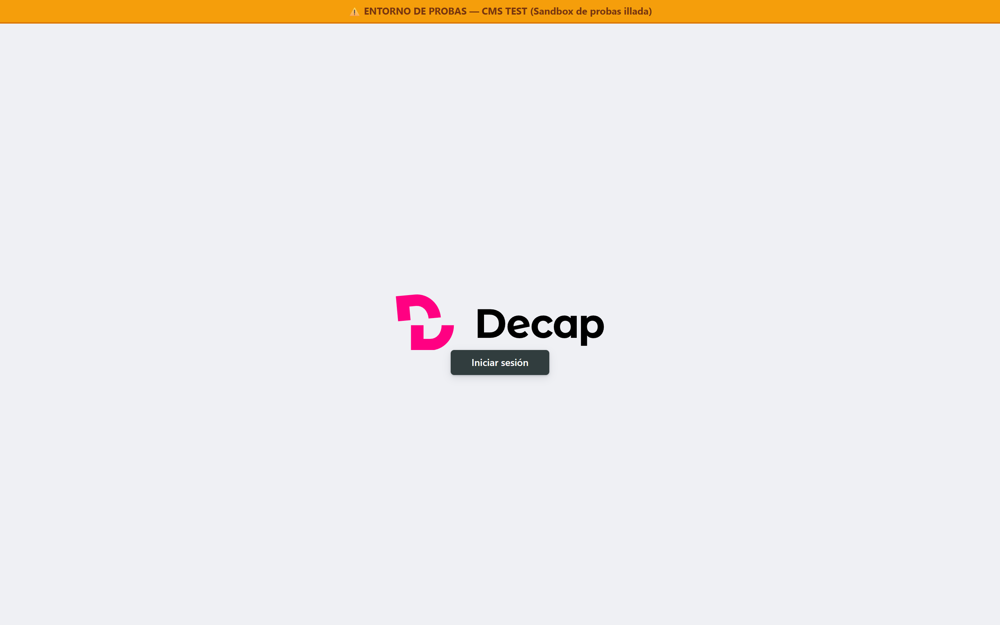
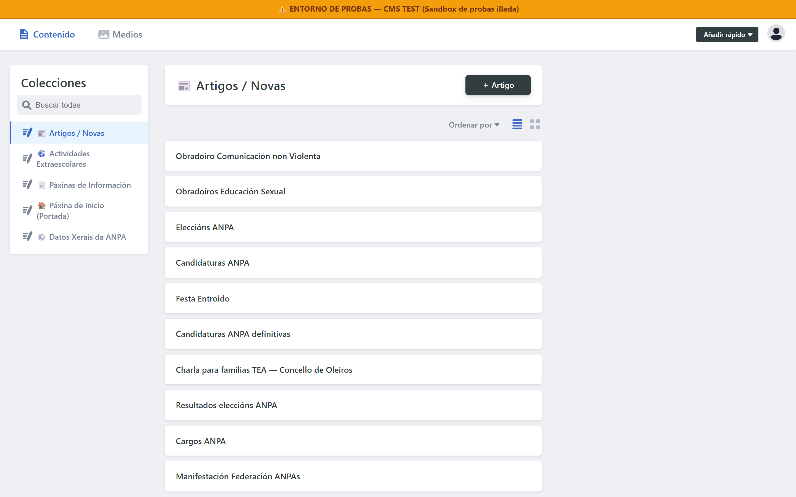

# Módulo 1: Conceptos Básicos y Acceso al Panel de Control

En este módulo aprenderás qué es el gestor de contenidos de la ANPA, cómo funciona por dentro de forma sencilla y los pasos exactos para acceder a tu panel de administración.

---

## 1. ¿Qué es un CMS y qué es Decap CMS?

Un **CMS** (*Content Management System* o Gestor de Contenidos) es una herramienta web que te permite cambiar los textos, fotos y avisos de una página web rellenando formularios sencillos, exactamente igual que si estuvieras escribiendo un correo electrónico o un documento en Word. No necesitas saber programación, ni tocar código HTML o CSS.

Nuestra web utiliza **Decap CMS** (anteriormente conocido como Netlify CMS). Es un gestor de contenido libre y de código abierto que tiene tres grandes ventajas para nuestra asociación:
* **Coste cero permanente:** No pagamos suscripciones mensuales ni cuotas de software.
* **Máxima seguridad:** La web no tiene bases de datos tradicionales que puedan ser atacadas o hackeadas.
* **Todo queda respaldado:** Cada cambio que guardas queda archivado con fecha, hora y autor en el repositorio de la ANPA.

---

## 2. Los cuatro pilares de la web de la ANPA

Para entender qué ocurre cuando tocas una tecla, conviene conocer a los cuatro amigos que hacen funcionar nuestra página:

```
[Decap CMS]  --->  [GitHub]  --->  [Eleventy]  --->  [Netlify]  --->  [Familias]
(Tú escribes)    (Guarda datos)   (Monta la web)    (La publica)    (La leen)
```

1. **Decap CMS (Tu panel de trabajo):** Es la pantalla a la que entras con tu navegador en `https://anpa-rabadeira-cms-test.netlify.app/admin/`. Aquí redactas noticias, cambias horarios o subes documentos.
2. **GitHub (El archivador seguro):** Es el almacén en la nube donde se guardan todos los archivos de texto, imágenes y código de la web. Cuando tú pulsas "Guardar", Decap CMS guarda los datos en GitHub.
3. **Eleventy (El constructor):** Es el motor informático que coge tus textos, los junta con el diseño y genera las páginas de la web.
4. **Netlify (El distribuidor veloz):** Es el servidor en internet que aloja la web construida y se la entrega al instante a las familias cuando entran desde su móvil u ordenador.

---

## 3. Requisitos previos para poder entrar

Para poder administrar la página necesitas únicamente dos cosas:

1. **Una cuenta de usuario en GitHub:** Es gratuita y puedes crearla en [github.com/signup](https://github.com/signup) con tu correo electrónico personal.
2. **Invitación de la ANPA:** La persona administradora del repositorio de la ANPA debe haber añadido tu usuario de GitHub como **colaborador con permiso de escritura** (*Write access*) en el repositorio `NikyMuchi/anpa-rabadeira-cms-test` (o en el repositorio definitivo). Si intentas entrar sin esta invitación previa, el sistema te mostrará un mensaje de error rojo de autorización.

---

## 4. Paso a paso: Cómo entrar al panel de administración

Sigue estos sencillos pasos desde tu ordenador o tableta (recomendamos usar Google Chrome, Mozilla Firefox, Microsoft Edge o Safari):

1. Abre tu navegador web habitual.
2. Escribe en la barra de direcciones la URL de administración:
   ```
   https://anpa-rabadeira-cms-test.netlify.app/admin/
   ```
   *(También puedes entrar desde la web pública bajando hasta el pie de página y haciendo clic en el enlace discreto que dice **🔒 Acceso administración**).*


*Figura 1: Pantalla de inicio de sesión de Decap CMS en `/admin/` mostrando el aviso de entorno de pruebas y el botón central de acceso.*

3. Haz clic en el botón azul: **Login with GitHub** (o **Iniciar sesión**).
4. Se abrirá una pequeña ventana emergente (*popup*):
   * Si ya tenías tu sesión de GitHub abierta en ese navegador, la ventana parpadeará unos segundos, confirmará tus permisos y se cerrará sola.
   * Si no tenías la sesión abierta, introduce tu correo/usuario de GitHub y tu contraseña, y pulsa en **Sign in**.
5. Si es tu primera vez, GitHub te pedirá que autorices a la aplicación de la ANPA a gestionar el contenido. Haz clic en el botón verde **Authorize**.
6. ¡Listo! La ventana emergente se cerrará y accederás directamente al panel principal de administración de la ANPA.

> ⚠️ **Nota sobre verificación en vivo:** La apertura y cierre automático de la ventana de GitHub OAuth depende de que tu navegador permita las ventanas emergentes (*popups*) en esta dirección. Si pulsas el botón y no ocurre nada, revisa si tu navegador tiene un icono en la barra de direcciones que dice "Ventana emergente bloqueada" y pulsa "Permitir siempre".

---

## 5. Recorrido visual por el panel de control

Al entrar, te encontrarás con una interfaz limpia y organizada en tres grandes zonas:


*Figura 2: Panel principal de Decap CMS con la barra superior de navegación, la barra lateral con las 5 colecciones y el listado de artículos.*

### Zona A: La barra lateral izquierda (Las Colecciones)
En el margen izquierdo verás las 5 secciones o archivadores temáticos de la web:
* 📰 **Artigos / Novas (Noticias):** Donde se redactan y publican todos los avisos y comunicados periódicos.
* ⚽ **Actividades Extraescolares:** Ficha única donde se ajusta el curso escolar, se sube el cartel de horarios, se gestionan las 18 actividades y sus plazas, y se actualizan los precios y normas.
* 📄 **Páxinas de Información:** Contiene 5 páginas fijas e imprescindibles del colegio:
  - 🌅 Servizo de Madrugadores
  - 🍽️ Pago do Comedor (Guía ATRIGA de 11 pasos)
  - 📝 Alta de Socios / Inscrición (Cuota e IBAN)
  - 📊 Memoria de Actividades (Descarga de memorias en PDF)
  - 🏛️ Consello Escolar (Información institucional y enlace al blog de las familias)
* 🏠 **Páxina de Inicio (Portada):** Textos de bienvenida de la página principal, foto representativa de la comunidad, las 4 tarjetas de acceso rápido y el bloque de contacto inferior.
* ⚙️ **Datos Xerais da ANPA:** El nombre oficial, la descripción para Google y el correo de contacto general de la asociación.

### Zona B: La barra superior
En la parte superior verás dos botones o pestañas de navegación:
* **Contenido:** Es la vista por defecto. Te muestra los archivadores y te permite crear o editar cualquier texto.
* **Flujo editorial (Workflow):** Un tablero visual que te muestra en qué estado se encuentra cada contenido (Borrador, En revisión o Listo para publicar). Lo explicaremos a fondo en el Módulo 2.
* **Acceso a la Biblioteca de Medios:** Un botón en forma de icono de imágenes donde puedes ver todos los archivos y fotos subidos a la web.
* **Tu perfil de usuario:** Arriba a la derecha verás tu foto o avatar de GitHub. Si pulsas sobre él, verás la opción **Cerrar sesión** (*Log out*).

---

## 6. Cómo cerrar sesión de forma segura

Cuando termines de trabajar en la web, especialmente si estás utilizando un ordenador compartido:
1. Haz clic sobre tu avatar en la esquina superior derecha del panel.
2. Haz clic en **Cerrar sesión** (*Log out*).
3. Cierra la pestaña del navegador.
