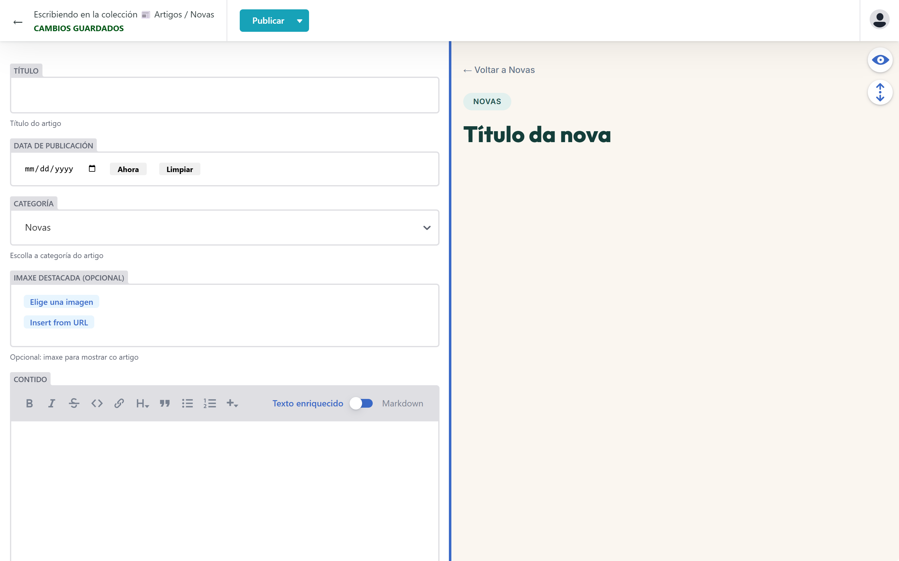
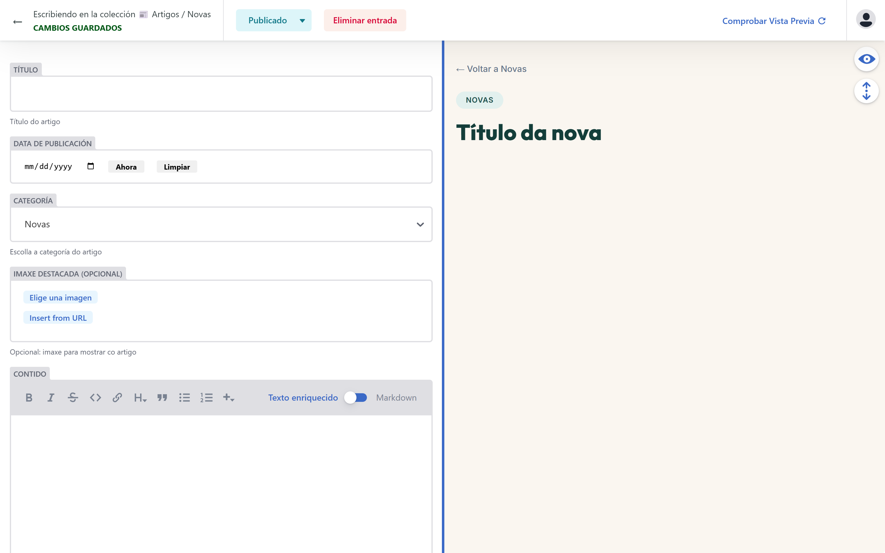

# Módulo 3: Gestión de Noticias y Avisos (Novas)

En este módulo aprenderás a redactar, ilustrar y publicar comunicados oficiales, avisos urgentes y noticias de actividades para toda la comunidad escolar del CEIP Rabadeira.

---

## 1. ¿Qué es esta función?
Es el tablón de anuncios digital de la ANPA. Cada noticia que redactas aquí se publica automáticamente en dos sitios de la web:
1. En la página de archivo general de noticias (`/novas/`), donde se guardan organizadas por fecha.
2. En la portada principal del sitio web (`/`), donde se muestran de forma destacada las 3 noticias más recientes.

---

## 2. ¿Cuándo y por qué usarla?
Debes crear una noticia siempre que la ANPA necesite comunicar algo a las familias:
* Convocatorias de Asambleas Generales Ordinarias o Extraordinarias.
* Fechas de apertura o cierre de inscripciones a actividades.
* Fiestas escolares organizadas por la ANPA (Magosto, Navidad, Entroido, Fin de Curso).
* Charlas para familias, talleres formativos o jornadas educativas.
* Comunicados urgentes sobre servicios (comedor, transporte o madrugadores).

---

## 3. Explicación de las casillas del formulario

Al pulsar en **Novo Artigo** (Nuevo Artículo), verás los siguientes campos:

| Nombre en pantalla (Gallego) | Significado en Español | ¿Obligatorio? | ¿Cómo se rellena? |
| :--- | :--- | :---: | :--- |
| **Título** | Título de la noticia | **Sí** | Frase corta y clara que resuma el tema (ej: *Convocatoria de Asemblea Xeral Ordinaria*). |
| **Data de publicación** | Fecha de publicación | **Sí** | Haz clic en el calendario y selecciona el día en que quieres que figure la noticia. |
| **Categoría** | Categoría temática | **Sí** | Desplegable con 5 opciones oficiales: `Novas`, `ANPA`, `Actividades`, `Extraescolares`, `Socios ANPA`. |
| **Imaxe destacada** | Imagen de cabecera | No (Opcional) | Fotografía o cartel en formato horizontal (JPG, PNG o WebP) que encabezará el artículo. |
| **Deseño (Layout)** | Plantilla técnica | **Automático** | Es un campo técnico oculto (`layouts/post.njk`). **No debes tocarlo**. |
| **Contido** | Cuerpo del artículo | **Sí** | El texto completo de la noticia. Dispone de barra de formato para negritas, listas y enlaces. |


*Figura 6: Formulario en blanco de `posts` al hacer clic en "Novo Artigo", con los campos de título, fecha, categoría, imagen destacada y editor de contenido.*

---

## 4. Paso a paso para redactar y publicar una noticia

1. Entra en el panel de administración (`/admin/`).
2. En la columna izquierda, haz clic en **📰 Artigos / Novas**.
3. Haz clic en el botón superior azul: **Novo Artigo**.
4. Escribe el **Título** de tu noticia.
5. Selecciona la **Data de publicación** en el selector.
6. Elige la **Categoría** que mejor encaje en el desplegable.
7. *(Opcional)* Si tienes un cartel o fotografía, pulsa en **Elegir una imagen** bajo `Imaxe destacada`:
   * Haz clic en **Subir imagen** para elegirla desde tu ordenador.
   * O selecciona una que ya estuviera subida en la biblioteca.
8. En la casilla **Contido**, escribe el texto de tu comunicado:
   * Puedes poner texto en negrita seleccionándolo y pulsando en la **B** de la barra superior.
   * Puedes crear listas con viñetas o números para que se lea mejor.
   * Puedes añadir enlaces a páginas web externas seleccionando el texto y pulsando en el icono de la cadena (🔗).
9. Comprueba la **Vista previa** en el lado derecho de la pantalla para asegurarte de que todo tiene buen aspecto.
10. En la barra superior, pulsa el botón azul **Guardar** (tu borrador ya está seguro).
11. Cuando decidas publicarlo, pulsa en el botón verde **Publicar** -> **Publicar ahora**.

---

## 5. Ejemplo práctico realista

**Situación:** La directiva convoca el taller de familias sobre educación digital.
* **Título:** *Obradoiro para familias: Uso responsable de pantallas e móbiles*
* **Data de publicación:** `2026-11-20`
* **Categoría:** *Actividades*
* **Imaxe destacada:** Cartel del taller subido desde el ordenador (`obradoiro-pantallas.jpg`).
* **Contido:**
  ```markdown
  Convidamos a todas as familias do CEIP Rabadeira a participar no noso vindeiro obradoiro formativo.

  - **Data:** Xoves 27 de novembro de 2026
  - **Horario:** 18:00 a 19:30 h
  - **Lugar:** Biblioteca do colexio
  - **Relator:** Especialista en seguridade dixital e menores

  Haberá servizo de gardaría para quen o precise previa inscrición. ¡Agardámoste!
  ```

---

## 6. Qué se puede cambiar con total tranquilidad
* El título y el cuerpo del texto en cualquier momento.
* La imagen destacada (puedes cambiarla o quitarla).
* La categoría asignada.
* Corregir faltas de ortografía o fechas tras haber publicado.

## 7. Qué NO se debe cambiar jamás
* **No toques el campo técnico de diseño (`layout`):** El sistema lo mantiene oculto para protegerlo.
* **No introduzcas formatos de fecha extraños:** Utiliza siempre el selector visual de calendario para evitar que la noticia pierda su orden cronológico.

---

## 8. Cómo comprobar el resultado en la web
1. Espera entre **1 y 2 minutos** tras haber pulsado "Publicar ahora".
2. Abre una pestaña nueva en tu navegador y visita:
   ```
   https://anpa-rabadeira-cms-test.netlify.app/novas/
   ```
3. Comprueba que tu artículo aparece en primera posición con su título, fecha, etiqueta de categoría e imagen.
4. Entra en la portada principal (`/`) y confirma que figura entre las tres novedades destacadas.
5. *(Opcional)* Prueba a buscar una palabra de tu titular en la lupa del buscador superior para verificar que ya está indexada.

---

## 9. Cómo eliminar una noticia antigua o errónea

Si una noticia ha quedado obsoleta o se creó por error:
1. En el panel izquierdo, haz clic en **📰 Artigos / Novas**.
2. Localiza la noticia en la lista y haz clic sobre ella para abrirla.
3. En la barra superior, haz clic en el botón rojo o menú de opciones: **Eliminar entrada** (*Delete entry*).
4. El sistema te pedirá confirmación: pulsa **Aceptar**.
5. En unos dos minutos, la noticia desaparecerá de la web y de la portada.


*Figura 7: Vista de una noticia en edición mostrando el botón "Eliminar entrada" para dar de baja avisos caducados o erróneos.*

---

## 10. Errores habituales y cómo solucionarlos

* **"He publicado la noticia pero no sale en la portada":**
  * *Causa:* La portada solo muestra las 3 noticias con fecha más reciente. Si has puesto una fecha antigua a la noticia, se ordenará más abajo en el archivo de `/novas/`.
  * *Solución:* Revisa la fecha de la noticia y asegúrate de que tiene la fecha de hoy.
* **"La foto se ve gigante o cortada":**
  * *Causa:* Subiste una fotografía vertical muy alargada tomada con el móvil.
  * *Solución:* Para las imágenes destacadas de noticias, utiliza siempre fotos con orientación horizontal (paisaje).
* **"He pulsado en Publicar ahora y la web sigue igual":**
  * *Solución:* Respeta el minuto y medio de compilación de Netlify y pulsa `Ctrl + F5` en tu navegador para forzar la actualización.
