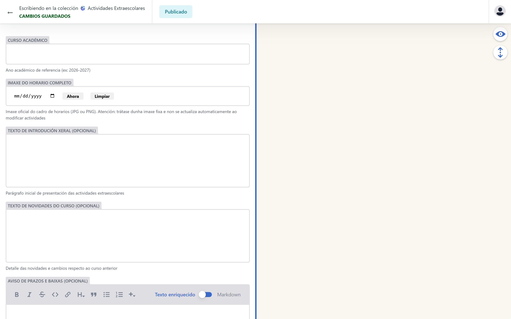
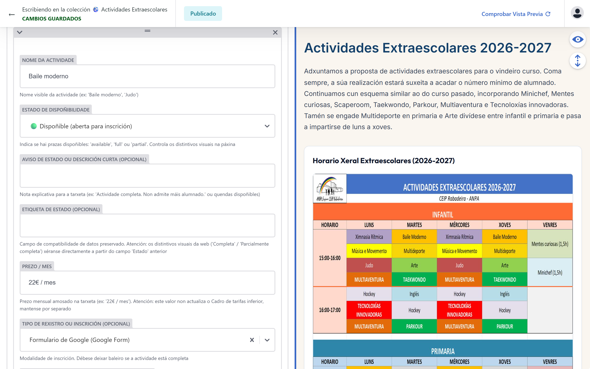
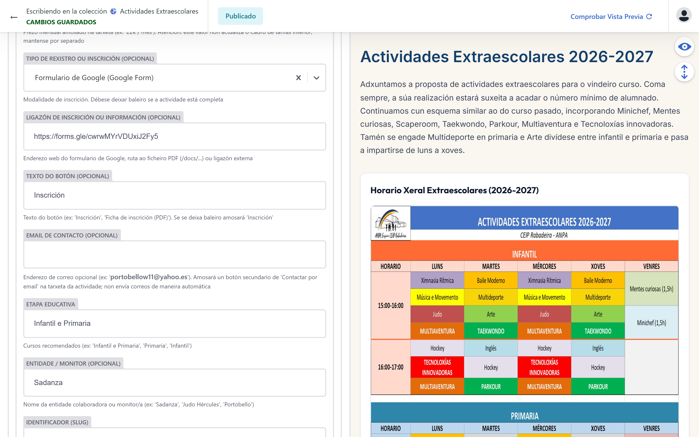
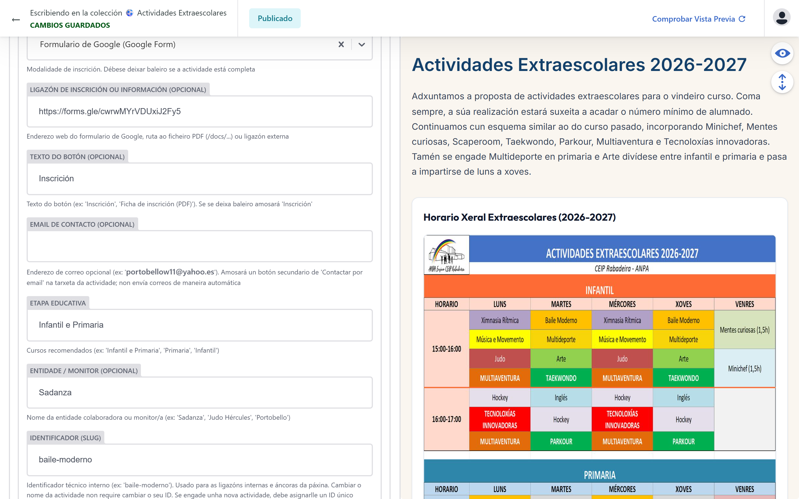

# Módulo 4: Gestión de Actividades Extraescolares

Este es el módulo más importante del sitio web. En él se gestiona toda la oferta de actividades del colegio: el curso escolar, el cartel oficial de horarios, las 18 actividades con sus estados de plazas, los precios, los formularios de inscripción y el reglamento de convivencia.

---

## 1. ¿Qué es esta sección?
Es la central de mandos de la página pública `/extraescolares/`. Toda la información de esta página está unificada en un único fichero protegido en el CMS para que no tengas que crear páginas sueltas por cada actividad.

---

## 2. ¿Cuándo y por qué usarla?
Debes entrar en esta sección principalmente en tres momentos del año:
1. **Inicio de curso (septiembre):** Para actualizar el año escolar (ej: de `2026-2027` a `2027-2028`), subir el nuevo cartel de horarios y renovar los enlaces de inscripción.
2. **Durante el periodo de inscripción:** Cuando los grupos se llenan y necesitas marcar una actividad como **Completa** o **Parcialmente completa** para que las familias no sigan enviando solicitudes.
3. **Cambios de cuotas o monitores:** Si cambia una empresa proveedora, un precio mensual o las normas del servicio.

---

## 3. Estructura del editor de Extraescolares

En el panel lateral izquierdo, haz clic en **⚽ Actividades Extraescolares** y luego en la ficha **Xestión de Extraescolares**.

El formulario está organizado en bloques lógicos. Algunos aparecen colapsados (cerrados) para que la pantalla sea más cómoda de leer. Puedes abrirlos y cerrarlos haciendo clic sobre su título:

```
[ Xestión de Extraescolares ]
 ├── Curso académico e imaxe do horario
 ├── Textos de introdución e avisos de prazos
 ├── Socios e Matrícula (Bloque colapsable)
 ├── Listado de Actividades (18 actividades colapsables)
 ├── Cadro de tarifas e cotas (Bloque colapsable)
 ├── Condicións xerais do servizo (Markdown enriquecido)
 ├── Marco Legal de Convivencia (Markdown enriquecido)
 └── Imaxe do Plan Corresponsables
```


*Figura 8: Cabecera del formulario de Extraescolares mostrando el curso académico, la imagen del cuadro horario general y los avisos de plazos.*

---

## 4. Las 18 Actividades Oficiales: Guía casilla por casilla

Bajo el encabezado **Listado de Actividades (18 actividades)** encontrarás la lista completa de actividades que ofrece la ANPA:

1. Baile moderno
2. Multideporte
3. Ioga
4. Baloncesto
5. Arte
6. Multiaventura
7. Teatro musical
8. Música e movemento
9. Tecnoloxías Innovadoras
10. Judo
11. Ximnasia rítmica
12. Inglés
13. Taekwondo
14. Parkour
15. Hockey
16. Minichef
17. Scape room
18. Mentes curiosas

Al hacer clic sobre cualquiera de ellas, se desplegarán sus 12 casillas ordenadas:


*Figura 9: Ficha desplegada de una actividad (Baile moderno) mostrando su nombre, selector de disponibilidad de plazas y precio mensual.*

| Campo en pantalla (Gallego) | Significado en Español | ¿Qué hace y cómo se usa? |
| :--- | :--- | :--- |
| **Nome da actividade** | Nombre de la actividad | El título visible de la actividad (ej: *Baile moderno*, *Judo*). |
| **Estado de dispoñibilidade** | Disponibilidad de plazas | **Desplegable con 3 opciones:**<br>• 🟢 `available`: Plazas disponibles (abierta). Muestra el botón de inscripción.<br>• 🔴 `full`: Completa. Muestra la insignia roja "Completa" y **oculta automáticamente el botón de inscripción**.<br>• 🟡 `partial`: Parcialmente completa. Muestra la insignia amarilla. |
| **Aviso de estado ou descrición curta** | Aviso de turnos o plazas | Texto explicativo en cursiva dentro de la tarjeta (ej: *A quenda de Luns e Mércores está completa. Resto de quendas dispoñibles*). |
| **Etiqueta de estado** | Etiqueta de compatibilidad | Campo técnico de compatibilidad. *(Las insignias visuales se generan solas a partir del campo anterior de Estado)*. |
| **Prezo / mes** | Precio mensual visible | Texto que aparece en la tarjeta (ej: `22€ / mes`). **Atención:** No modifica el cuadro de tarifas del pie de página (se actualiza por separado). |
| **Tipo de rexistro ou inscrición** | Modo de inscripción | Desplegable: `google_form` (Google Form), `pdf` (Ficha en PDF) o `external_url` (Web externa). Si la actividad está completa, se deja vacío. |
| **Ligazón de inscrición ou información** | Enlace de inscripción | La dirección web (`https://forms.gle/...`) o ruta al PDF. |
| **Texto do botón** | Texto del botón | Si se deja vacío, el botón muestra la palabra *"Inscrición"*. Puedes poner *"Ficha de inscrición (PDF)"* u otro texto si lo deseas. |
| **Email de contacto** | Correo electrónico de dudas | Si una actividad la gestiona directamente una persona o empresa externa (ej: `portobellow11@yahoo.es`), poner aquí el correo mostrará un botón secundario que dice **"Contactar por email"**. *(No envía correos automáticamente; abre el programa de correo del usuario)*. |
| **Etapa educativa** | Cursos escolares | Etapa recomendada (ej: `Infantil e Primaria`, `Primaria`). |
| **Entidade / Monitor** | Empresa o monitor | Entidad colaboradora si procede (ej: `Sadanza`, `Portobello`). |
| **Identificador (slug)** | Código técnico permanente | ⛔ **LA REGLA DE ORO: ¡NO TOCAR!** Código interno en minúsculas (ej: `baile-moderno`). Mantiene vivas las anclas de la web (`#act-baile-moderno`). |


*Figura 10: Detalle de los campos de registro: tipo de inscripción (Google Form), enlace, texto del botón y correo electrónico de contacto.*


*Figura 11: Detalle del campo `Identificador (slug)` con su aviso de preservación permanente para salvaguardar los enlaces internos de la web.*

---

## 5. Tutorial Práctico 1: ¿Qué hacer cuando una actividad se llena?

**Ejemplo realista:** El grupo de *Judo* ha cubierto todas las plazas disponibles.

1. Entra en `/admin/` -> **⚽ Actividades Extraescolares** -> **Xestión de Extraescolares**.
2. Despliega la lista **Listado de Actividades**.
3. Haz clic sobre **Judo** para abrir sus datos.
4. En la casilla **Estado de dispoñibilidade**, cambia la opción a:
   `🔴 Completa (sen prazas dispoñibles)`
5. En la casilla **Aviso de estado ou descrición curta**, escribe:
   `Actividade completa. Non admite máis alumnado.`
6. Comprueba en la vista previa de la derecha que la tarjeta de Judo ahora luce la insignia roja **Completa** y que el botón de inscribirse ha desaparecido para que ninguna familia se confunda.
7. Pulsa en **Guardar** y luego en **Publicar** -> **Publicar ahora**.


*Figura 12: Estado de disponibilidad marcado como "Completa (sen prazas dispoñibles)", con aviso explicativo y precio mensual.*

---

## 6. Tutorial Práctico 2: Cómo renovar el cartel oficial de horarios

**Ejemplo realista:** Comienza el curso 2026-2027 y la comisión de extraescolares ha diseñado la nueva imagen con los horarios semanales.

1. Abre **Xestión de Extraescolares**.
2. En la casilla **Curso académico**, comprueba o escribe el curso correspondiente: `2026-2027`.
3. Bajo **Imaxe do Horario Completo**, verás la imagen actual. Haz clic en el botón **Elegir una imagen**.
4. En la ventana emergente, pulsa en **Subir imagen** y selecciona el nuevo archivo JPG o PNG de horarios desde tu ordenador.
5. Comprueba en la vista previa que el nuevo cuadro se lee con nitidez y permite desplazamiento horizontal en pantallas pequeñas.
6. Pulsa en **Guardar** y luego en **Publicar** -> **Publicar ahora**.

---

## 7. Diferencia crítica: Tarjetas de actividad vs. Cadro de tarifas

> ⚠️ **ATENCIÓN: ERROR MUY HABITUAL**
> Cada tarjeta de actividad tiene su propia casilla de precio (`Prezo / mes`).
> Al final de la página web hay una tabla resumen titulada **Cadro de tarifas e cotas**.
> **Estos dos sitios no están conectados de forma automática.**
> Si la ANPA aprueba subir o bajar el precio de una actividad (por ejemplo, *Ioga* pasa de 22 € a 25 €), debes actualizar el precio en **ambos sitios**:
> 1. En la casilla `Prezo / mes` dentro de la tarjeta de la actividad.
> 2. En el bloque colapsable **Cadro de tarifas e cotas**, buscando la fila correspondiente a esa actividad.

---

## 8. Condiciones Generales y Convivencia (Markdown enriquecido)

Al final del formulario encontrarás dos bloques normativos:
* **Condicións xerais do servizo:** Las 14 normas oficiales de funcionamiento (recogidas, seguros, días de pago, plazos de baja antes del día 20).
* **Marco Legal de Convivencia:** La transcripción de la Ley 4/2011 sobre faltas graves y leves.

Ambos bloques utilizan un editor tipo procesador de textos con barra de herramientas. Si necesitas actualizar un texto normativo, simplemente haz clic sobre el párrafo, escribe la modificación y aplica negritas o listas si lo necesitas.

---

## 9. Imagen institucional del Plan Corresponsables

Al pie de la página de extraescolares figura la imagen oficial del **Plan Corresponsables (Xunta de Galicia)**.
* Si el convenio cambia de logotipo o convocatoria, puedes pulsar en **Elegir una imagen** en la casilla `Imaxe Plan Corresponsables (opcional)`.
* **Seguridad garantizada:** Si dejas esa casilla completamente en blanco, el sistema restaurará de forma automática y transparente la imagen oficial predeterminada (`/img/extraescolares-corresponsables.jpg`).

---

## 10. Errores habituales y soluciones en Extraescolares

* **"He modificado el precio en la tarjeta pero en la tabla del final sigue saliendo el antiguo":**
  * *Solución:* Acuérdate de abrir el bloque **Cadro de tarifas e cotas** y actualizar la fila correspondiente.
* **"He cambiado el nombre de la actividad y se ha roto el enlace del menú":**
  * *Causa:* Tocaste por error la casilla `Identificador (slug)`.
  * *Solución:* Vuelve a escribir el identificador original en minúsculas y sin acentos (por ejemplo `baile-moderno`).
* **"Una familia se inscribió a una actividad que ya estaba llena":**
  * *Causa:* Se te olvidó cambiar el desplegable a `🔴 Completa`. Mientras esté en `available`, el botón sigue activo.
