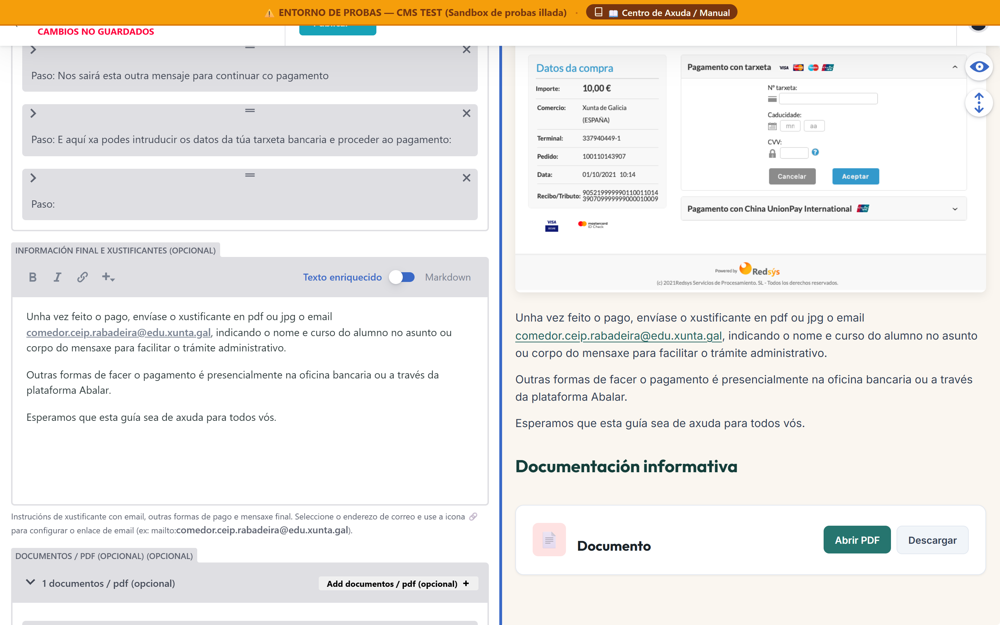

# Módulo 6: Pago de Comedor Escolar (Guía ATRIGA)

El pago del comedor escolar del CEIP Rabadeira se realiza de forma telemática a través de la Axencia Tributaria de Galicia (ATRIGA). Para muchas familias nuevas de Infantil y Primaria, este trámite resulta confuso al principio.

En este tutorial aprenderás a gestionar y actualizar la página `/comedor/`, incluyendo los textos explicativos y la **guía ilustrada de 11 pasos con capturas de pantalla reales**.

---

## 1. ¿Qué es la página de Comedor y qué información contiene?

Controla la página `/comedor/`. Su objetivo es guiar a las familias paso a paso para que puedan pagar el recibo mensual del comedor escolar por internet desde su casa, con tarjeta bancaria o certificado digital, sin tener que acudir presencialmente al banco ni al colegio.

La página contiene:
1. **Párrafo introductorio:** Contexto y enlace a las instrucciones del centro escolar.
2. **Acceso directo a ATRIGA:** Enlace directo al portal tributario oficial de la Xunta (`https://ovt.atriga.gal`).
3. **Guía ilustrada de 11 pasos:** Cada paso muestra una captura de pantalla real de la web de ATRIGA acompañada de un texto claro que le dice a la familia exactamente dónde pulsar.
4. **Instrucciones para enviar el justificante:** El correo oficial de comedor del colegio (`comedor.ceip.rabadeira@edu.xunta.gal`) y qué poner en el asunto (nombre y curso del alumno).
5. **Formas alternativas de pago:** Pago presencial en entidad bancaria o a través de la aplicación oficial Abalar.
6. **Documentos adicionales en PDF (opcional):** Posibilidad de adjuntar folletos o circulares de comedor.

---

## 2. Cómo acceder al editor de Comedor en Decap CMS

1. Entra en `/admin/` e inicia sesión con tu cuenta de GitHub.
2. En la barra lateral izquierda, localiza **📄 Páxinas de Información**.
3. Haz clic en **🍽️ Pago do Comedor**.

---

## 3. ¿Qué casillas y campos verás en pantalla?

El formulario está organizado de forma muy intuitiva:

| Campo en pantalla (Gallego) | Nombre en Español | Tipo | ¿Para qué sirve? |
| :--- | :--- | :---: | :--- |
| **Título da páxina** | Título principal | Texto | Encabezado H1 (*Pago Comedor*). |
| **Imaxe destacada (opcional)** | Imagen de cabecera | Imagen | Fotografía opcional de cabecera. |
| **Texto alternativo da imaxe (Alt)** | Descripción accesible | Texto | Descripción para personas con discapacidad visual. |
| **Texto introdutorio** | Párrafo de bienvenida | Markdown | Texto de bienvenida con enlace a la web oficial del colegio. |
| **Información de pagamento (ATRIGA)** | Bloque portal ATRIGA | Markdown | Subtítulo H2 y enlace directo al portal tributario. |
| **Pasos da guía ilustrada (11 pasos)** | Lista de 11 pasos | Lista | Los 11 pasos secuenciales con texto, imagen de captura y texto alternativo. |
| **Información final e xustificantes** | Justificantes y cierre | Markdown | Correo para enviar el justificante, vías alternativas (Abalar) y despedida. |
| **Documentos / PDF (opcional)** | Guías en PDF | Lista | Para subir guías en PDF si se desea. |

*Figura 14: Vista general del editor de Comedor en Decap CMS mostrando los campos de título, texto introductorio e información de ATRIGA.*

---

## 4. Los 11 pasos oficiales de la guía de ATRIGA

Cada paso de la lista contiene tres campos:
* `Texto explicativo`: La instrucción de lo que hay que hacer en esa pantalla.
* `Imaxe do paso`: La captura de pantalla en formato PNG o JPG guardada en `/img/comedor/`.
* `Descrición da imaxe (accesibilidade)`: Texto de accesibilidad (ej: *Paso 1 - Portal ATRIGA*).

*Figura 15: Detalle de los pasos ilustrados de la guía de pago de ATRIGA con campos de descripción y captura adjunta.*

### La secuencia oficial de los 11 pasos:
1. **Paso 1:** *No apartado de CIDADÁNS, premes iniciar taxa* (Captura `/img/comedor/paso-1.png`).
2. **Paso 2:** *Candado aberto é para o acceso libre ao servizo. Pechado se tedes certificado dixital* (Captura `/img/comedor/paso-2.png`).
3. **Paso 3:** *Sen certificado dixital podes facer o pago a través da TPV* (Captura `/img/comedor/paso-3.png`).
4. **Paso 4:** *Tedes que poner estes códigos para o pagamento do comedor:* (Captura `/img/comedor/paso-4.png`).
5. **Paso 5:** *Completar os datos requeridos:* (Captura `/img/comedor/paso-5.png`).
6. **Paso 6:** *Premer pagamento telemático:* (Captura `/img/comedor/paso-6.png`).
7. **Paso 7:** *Na seguinte pantalla premer continuar co tipo de pagamento «telemático» e modo de pagamento «tarxeta»* (Captura `/img/comedor/paso-7.png`).
8. **Paso 8:** *Sairá esta outra pantalla, e premer ingresar:* (Captura `/img/comedor/paso-8.png`).
9. **Paso 9:** *Nos sairá esta outra mensaje para continuar co pagamento* (Captura `/img/comedor/paso-9.png`).
10. **Paso 10:** *E aquí xa podes intruducir os datos da túa tarxeta bancaria e proceder ao pagamento:* (Captura `/img/comedor/paso-10.png`).
11. **Paso 11:** *Proceder ao pagamento e gardar o xustificante* (Captura `/img/comedor/paso-11.png`).

---

## 5. Tutorial Práctico: Cómo sustituir una captura si la Xunta cambia el diseño de ATRIGA

**Ejemplo realista:** La Agencia Tributaria de Galicia renueva la pantalla de inicio y la captura del Paso 1 ha quedado antigua.

1. Abre **🍽️ Pago do Comedor**.
2. Despliega la lista **Pasos da guía ilustrada (11 pasos)**.
3. Haz clic sobre la primera tarjeta (**Paso: No apartado de CIDADÁNS...**).
4. En el campo **Imaxe do paso**:
   * Haz clic en **Elegir una imagen**.
   * Pulsa en el botón superior **Subir imagen** (*Upload*) y selecciona tu nueva captura (`paso-1-novo.png`).
   * Pulsa en **Insertar**.
5. Si el botón de la Xunta ahora se llama de otra manera, adapta el texto en **Texto explicativo**.
6. Comprueba en la vista previa derecha que la nueva imagen sustituye a la antigua y se ve nítida.
7. Pulsa en **Guardar** y luego en **Publicar** -> **Publicar ahora**.

---

## 6. Tutorial Práctico: Cómo editar las instrucciones del justificante de pago

El bloque final **Información final e xustificantes** utiliza un editor de texto enriquecido en Markdown.

Si el colegio cambia de correo para la recepción de justificantes de comedor:
1. En el cuadro **Información final e xustificantes**, busca el correo electrónico:
   `[comedor.ceip.rabadeira@edu.xunta.gal](mailto:comedor.ceip.rabadeira@edu.xunta.gal)`
2. Selecciona el texto del correo y haz clic en el icono de la cadenita 🔗.
3. Actualiza tanto el texto visible como el enlace con `mailto:nuevo-correo@edu.xunta.gal`.
4. Pulsa en **Guardar** y luego en **Publicar** -> **Publicar ahora**.

---

## 7. Cómo adjuntar guías o impresos en PDF (opcional)

Si la ANPA o el colegio publican una circular informativa, el impreso de domiciliación bancaria o una guía tributaria oficial en PDF, puedes adjuntarla para que las familias la descarguen directamente desde la página de Comedor.

*Figura 16: Bloque inferior de documentos PDF opcionales para adjuntar guías tributarias o impresos de comedor.*

### A) Cómo añadir un documento PDF:
1. Dentro del editor de **🍽️ Pago do Comedor**, baja hasta el bloque **Documentos / PDF (opcional)** situado al final del formulario.
2. Si la lista está vacía, pulsa en el botón **Add documentos / pdf (opcional)**.
3. Se abrirá una tarjeta con tres casillas:
   * **Título do documento:** Nombre visible y descriptivo (ej: *Guía tributaria de axuda ATRIGA 2026-2027*).
   * **Ficheiro PDF:** Haz clic en **Elegir un archivo** -> **Subir archivo**, selecciona el documento PDF desde tu ordenador y pulsa en **Insertar**.
   * **Descrición breve:** Resumen aclaratorio que verán las familias bajo el título (ej: *Folleto oficial con instrucións de taxas e códigos de autoliquidación*).
4. En el panel de vista previa derecho verás cómo se genera automáticamente una tarjeta con el icono del documento y dos botones: **Abrir PDF** (para consultarlo en el navegador) y **Descargar** (para guardarlo en el móvil o equipo).

### B) Cómo eliminar o sustituir un documento PDF:
* **Para sustituir el archivo:** Pulsa sobre **Elegir un archivo** en la tarjeta existente y selecciona el nuevo documento PDF.
* **Para eliminarlo:** Pulsa en el icono de la papelera (**Eliminar**) situado en la esquina superior de la tarjeta del documento.

---

## 8. Qué se puede cambiar con total tranquilidad y qué no tocar
* ✅ **Se puede cambiar con tranquilidad:** Actualizar capturas de pantalla, retocar textos explicativos para que se entiendan mejor, añadir nuevas instrucciones o adjuntar un PDF de ayuda.
* 🚫 **NO desordenes los 11 pasos:** La guía está pensada para seguirse en orden estricto mientras la persona tiene abierta la web de ATRIGA en otra pestaña.
* 🚫 **NO elimines la advertencia sobre el nombre del alumno:** Indicar el nombre y curso del menor en el justificante es obligatorio para que el colegio pueda identificar de quién es cada pago bancario.

---

## 9. Errores habituales y soluciones
* **"He subido una captura y se ve gigante o borrosa":**
  * *Solución:* Toma capturas de pantalla en formato PNG con resolución nítida recortando solo la zona relevante de la ventana de ATRIGA, evitando capturar todo el escritorio de tu ordenador.
* **"El enlace al portal tributario da error":**
  * *Solución:* Comprueba que la dirección comience por `https://` (`https://ovt.atriga.gal`).
