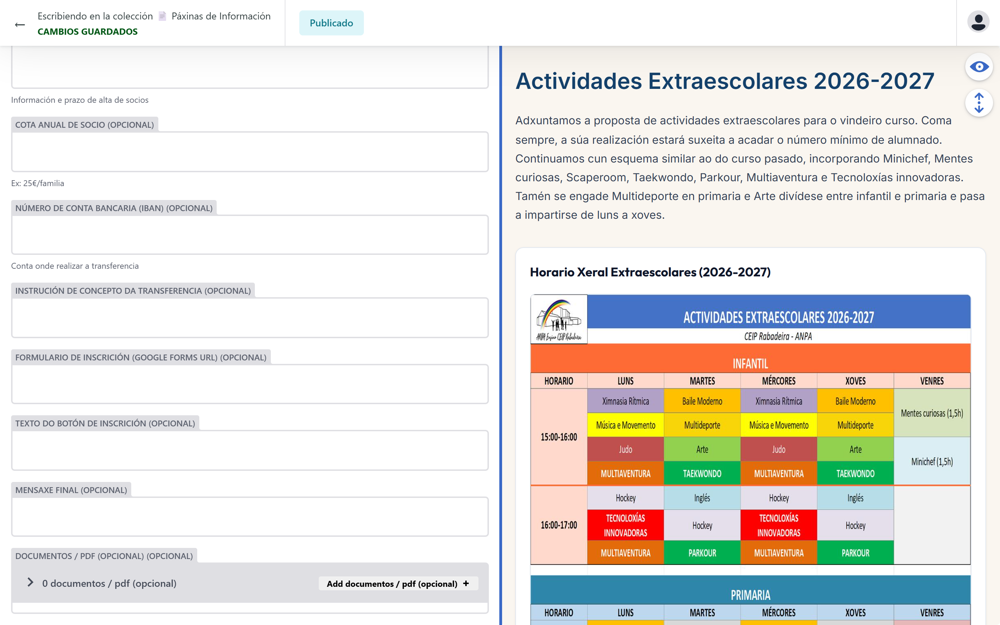

# Módulo 7: Alta de Socios e Inscripción (Inscrición)

Hacerse socio o socia de la ANPA permite a las familias financiar las actividades del colegio, disfrutar de tarifas reducidas en extraescolares y participar activamente en la vida escolar.

En este tutorial aprenderás a gestionar la página `/inscripcion/` y conocerás el **protocolo de máxima seguridad para el número de cuenta bancaria (IBAN)**.

---

## 1. ¿Qué es esta sección?
Controla la página de afiliación y bienvenida a nuevas familias (`/inscripcion/`). En ella se explica:
1. La necesidad de renovar la cuota de alta cada año (al no estar domiciliada por recibo bancario).
2. El importe de la cuota familiar anual (actualmente fijada en `25€/familia`).
3. El número de cuenta bancaria oficial de la ANPA en formato IBAN internacional.
4. Las instrucciones para indicar los apellidos del alumno o alumna en el concepto de la transferencia.
5. El botón de acceso directo al formulario oficial de Google Forms donde las familias rellenan sus datos y adjuntan el comprobante de pago.

---

## 2. Estructura del editor de Inscripción

En el menú lateral izquierdo, haz clic en **📄 Páxinas de Información** y abre **📝 Alta de Socios / Inscrición**.

Verás los siguientes campos:

| Nombre en pantalla (Gallego) | Significado en Español | ¿Qué contiene? |
| :--- | :--- | :--- |
| **Título da páxina** | Título principal | *Formulario Inscrición*. |
| **Imaxe destacada (opcional)** | Imagen de cabecera | Foto o logotipo opcional de cabecera. |
| **Texto alternativo da imaxe (Alt)** | Descripción accesible | Descripción de accesibilidad para la imagen. |
| **Texto explicativo (`intro`)** | Mensaje informativo | Explica el curso activo (ej: 2026-2027) y recuerda que la cuota se renueva cada año. |
| **Cota anual de socio** | Importe de la cuota | Ej: `25€/familia`. |
| **Número de conta bancaria (IBAN)** | Código IBAN de la cuenta | ⚠️ **ZONA DE MÁXIMA SEGURIDAD.** La cuenta corriente oficial de la ANPA. |
| **Instrución de concepto da transferencia** | Concepto para el banco | Recuerda indicar el nombre y apellidos del menor en la transferencia. |
| **Formulario de inscrición (Google Forms URL)** | Enlace a Google Forms | La dirección web de recogida de datos (`https://forms.gle/...`). |
| **Texto do botón de inscrición** | Rótulo del botón | *Acceder ao formulario de inscrición (Google Forms)*. |
| **Mensaxe final** | Despedida | Mensaje de cierre (*Grazas!*). |
| **Documentos / PDF (opcional)** | Folletos descargables | Permite añadir la ficha de alta en PDF para quien prefiera hacerla en papel. |


*Figura 17: Formulario de edición de Inscripción mostrando la cuota anual, casilla de IBAN bancario y enlace al formulario de Google Forms.*

---

## 3. 🚨 ALERTA CRÍTICA: La Regla de Oro del IBAN Bancario

El número de cuenta bancaria (`bank_iban`) se muestra en la web pública dentro de un bloque especial destacado con fondo protector y letra monoespaciada para facilitar la lectura a las familias:

```
+-------------------------------------------------------------+
| Número de conta (IBAN)                                      |
| ES76 0049 2731 64 2114103625                                |
+-------------------------------------------------------------+
```

> 🛑 **PELIGRO EXTREMO DE ERROR HUMANO:**
> Si alguien modifica accidentalmente un solo número de esta casilla, **cientos de familias ingresarán la cuota de socio en una cuenta equivocada o el banco rechazará sus transferencias**.
>
> ### Protocolo obligatorio de 3 pasos antes de tocar el IBAN:
> 1. **NUNCA lo escribas de memoria ni a mano tecla por tecla:** Cópialo directamente del documento oficial del banco o certificado de titularidad de la ANPA.
> 2. **Comprueba el formato:** Debe comenzar por `ES` seguido de 22 dígitos (agrupados habitualmente en bloques de 4 para facilitar la lectura visual).
> 3. **Comprobación a cuatro ojos:** Si la directiva cambia de banco o de cuenta, otra persona de la directiva debe verificar visualmente el número en la vista previa antes de pulsar "Publicar ahora".

---

## 4. Tutorial Paso a Paso: Cómo renovar el enlace de Google Forms al inicio de curso

**Ejemplo realista:** Para el nuevo curso escolar, la directiva crea un nuevo formulario en Google Drive para recoger las altas.

1. Abre tu formulario en Google Forms y pulsa en **Enviar** -> icono de enlace (🔗) -> **Copiar enlace**.
2. Entra en el panel de administración (`/admin/`) -> **📄 Páxinas de Información** -> **📝 Alta de Socios / Inscrición**.
3. En la casilla **Texto explicativo (`intro`)**, comprueba que menciona el curso correcto (ej: *curso 2026-2027*).
4. En la casilla **Formulario de inscrición (Google Forms URL)**:
   * Borra el enlace antiguo.
   * Pega el nuevo enlace copiado de Google Forms (ej: `https://forms.gle/nrS3vcx7YGAskn5c8`).
5. Comprueba en la vista previa que el botón azul sigue funcionando y conduce al formulario nuevo.
6. Pulsa en **Guardar** y luego en **Publicar** -> **Publicar ahora**.

---

## 5. Qué se puede cambiar con seguridad y qué no tocar
* ✅ **Se puede cambiar con tranquilidad:** El texto explicativo de bienvenida, el año escolar mencionado, el enlace al formulario de Google Forms y añadir folletos en PDF.
* ⚠️ **Revisar con cuidado extremo:** La casilla `Cota anual de socio` (solo debe cambiarse si ha sido votado y aprobado en Asamblea General).
* 🛑 **ZONA ROJA:** La casilla `Número de conta bancaria (IBAN)`. No la toques a menos que la asociación haya abierto una cuenta bancaria diferente.

---

## 6. Errores habituales y soluciones
* **"Una familia dice que el enlace de inscripción da error":**
  * *Causa:* Al copiar el enlace de Google Forms, se seleccionó incompleto o se copió la dirección de edición interna (`/edit`) en lugar de la dirección pública de respuesta.
  * *Solución:* En Google Forms pulsa siempre en el botón superior **Enviar**, selecciona la pestaña de la cadenita 🔗 y pulsa **Copiar**. Pega esa dirección exacta en el CMS.
* **"He cambiado la cuota a 30 € pero en el texto sigue poniendo 25 €":**
  * *Solución:* Revisa la casilla `Texto explicativo (intro)` y la casilla `Cota anual de socio`. Asegúrate de que ambas coinciden con el importe aprobado.
