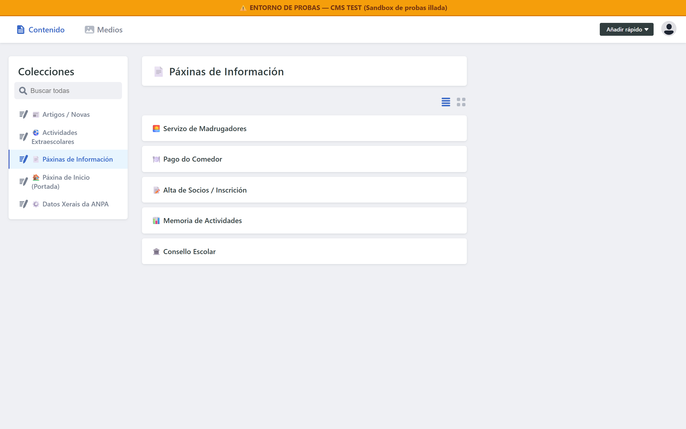
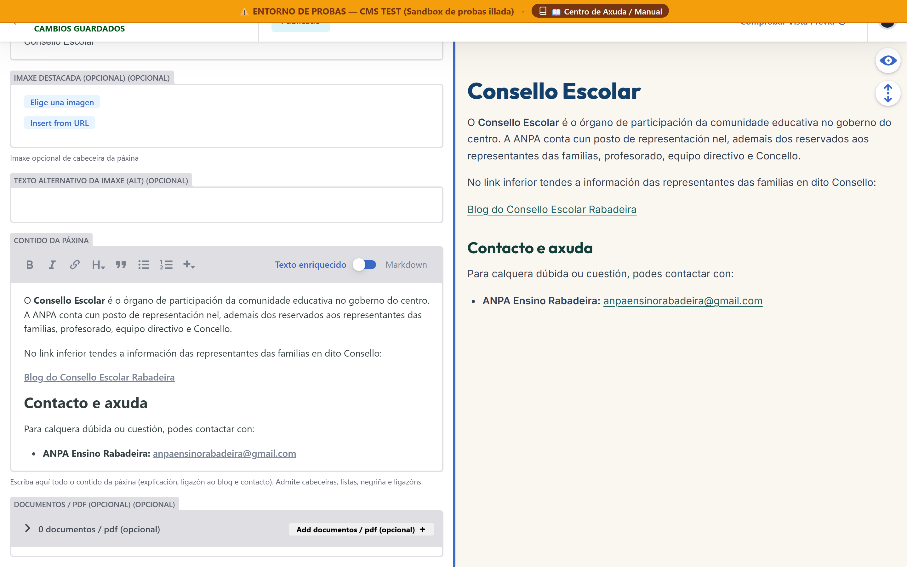
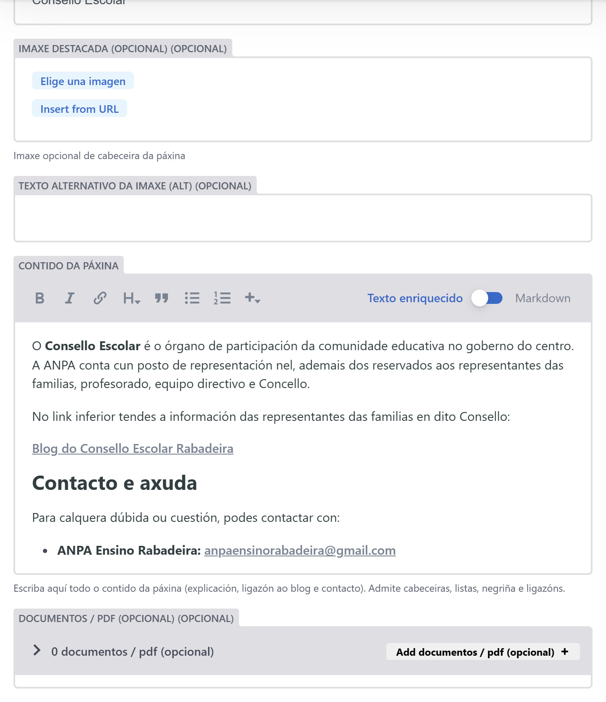

# Módulo 9: Consejo Escolar (Consello Escolar)

En este módulo aprenderás a gestionar y actualizar la página oficial del **Consejo Escolar** (`/consello-escolar/`) en la web de la ANPA Rabadeira.

Este tutorial está pensado para personas sin experiencia previa y cubre desde el formato del texto hasta la gestión de enlaces al blog externo de las familias, imágenes y documentos en PDF.

---

## 1. ¿Qué es la página del Consejo Escolar y qué información contiene?

El **Consejo Escolar** (*Consello Escolar*) es el órgano colegiado de gobierno del CEIP Rabadeira donde participa toda la comunidad educativa: el equipo directivo, el profesorado, el personal de administración y servicios, el representante del Ayuntamiento de Oleiros y las familias (madres, padres y personas tutoras legales).

La ANPA cuenta con un puesto de designación directa en este consejo, además de las personas representantes elegidas periódicamente en las elecciones escolares.

### ¿Qué ven las familias en la página `/consello-escolar/`?
1. **Explicación institucional:** Qué es el Consejo Escolar y cómo están representadas las familias.
2. **Enlace al blog externo de representantes:** Un acceso directo al blog independiente en WordPress (`https://conselloescolarrabadeira.home.blog/`), donde las representantes de las familias publican las actas, resúmenes y acuerdos de cada reunión.
3. **Punto de contacto y ayuda:** El correo de la ANPA para que cualquier familia pueda trasladar preguntas, quejas o propuestas a los representantes antes de cada sesión plenaria.
4. **Documentos informativos (opcional):** Posibilidad de descargar convocatorias, circulares o informes oficiales en PDF.

> ⚠️ **ACLARACIÓN CRÍTICA: NO ES UN BLOG DENTRO DEL CMS**
> La sección del Consejo Escolar es **una única página informativa estática**, no una colección de noticias o artículos sucesivos.
> No debes intentar crear entradas de blog aquí. Las publicaciones periódicas las realizan las representantes en su blog externo de WordPress. Nuestra página web sirve como portal oficial de referencia y enlace permanente para que la comunidad escolar sepa dónde acudir.

---

## 2. Cómo acceder al editor del Consejo Escolar en Decap CMS

Sigue estos pasos para abrir la ficha de edición:

1. Entra con tu navegador en el panel de administración:
   ```
   https://anpa-rabadeira-cms-test.netlify.app/admin/
   ```
2. Inicia sesión con tu cuenta de GitHub autorizada.
3. En la barra lateral izquierda, localiza la sección **📄 Páxinas de Información**.
4. Haz clic sobre el elemento titulado **🏛️ Consello Escolar**.


*Figura 19: Menú de Páxinas de Información en Decap CMS con el acceso directo a la ficha de Consello Escolar.*

---

## 3. ¿Qué significa "Editor de Documento Simple"?

A diferencia de otras secciones que tienen decenas de casillas rígidas y separadas, el **Editor de Documento Simple** funciona como una página en blanco de procesador de textos (tipo Microsoft Word o Google Docs):

* Todo el cuerpo principal de la página (la introducción, los títulos, los párrafos, los enlaces y los correos) se edita dentro de una única ventana de texto enriquecido llamada **Contido da páxina**.
* Esto te da total libertad para escribir, añadir párrafos, crear listas o cambiar los textos sin depender de casillas fijas que puedan limitar tu redacción.

---

## 4. Estructura detallada del editor y sus campos

Al abrir la ficha de Consejo Escolar, verás los siguientes campos en el formulario:

| Nombre en pantalla (Gallego) | Nombre en Español | Tipo | ¿Obligatorio? | ¿Qué contiene y para qué sirve? |
| :--- | :--- | :---: | :---: | :--- |
| **Título da páxina** | Título de la página | Texto | **Sí** | El titular H1 de la página. Por defecto: `Consello Escolar`. |
| **Imaxe destacada (opcional)** | Imagen de cabecera | Imagen | No | Fotografía o escudo representativo que se mostrará en la parte superior. |
| **Texto alternativo da imaxe (Alt)** | Descripción accesible | Texto | No | Breve frase que describe la imagen para personas con discapacidad visual. |
| **Contido da páxina** | Cuerpo principal | Markdown | **Sí** | Todo el texto explicativo, enlaces al blog, subtítulos y datos de contacto. |

*Figura 20: Formulario de edición de Consello Escolar con campos de título, imagen destacada, editor Markdown y vista previa maquetada.*

---

## 5. Cómo dar formato al texto principal (`Contido da páxina`)

El campo **Contido da páxina** cuenta con una barra de herramientas superior para que no tengas que escribir código técnico:

```
[ B ]  [ I ]  [ 🔗 ]  [ H2 ]  [ H3 ]  [ " ]  [ • ]  [ 1. ]
```

* **Negrita (`B`):** Selecciona una palabra o frase y pulsa la **B**. Se usa para resaltar nombres importantes (ej: **Consello Escolar**, **ANPA Ensino Rabadeira**).
* **Cursiva (`I`):** Para resaltar aclaraciones o notas secundarias.
* **Encabezados (`H2` y `H3`):** Para crear secciones ordenadas dentro del documento (por ejemplo: `## Contacto e axuda` o `### Representantes actuais`).
* **Listas con viñetas (`•`):** Para enumerar a los miembros o las funciones del consejo sin amontonar el texto.
* **Citas (`"`):** Para destacar frases institucionales o citas literales de la normativa.

---

## 6. Cómo gestionar enlaces web (añadir, modificar y borrar)

En esta página es fundamental saber gestionar enlaces, ya que aquí reside el acceso al blog de las familias del Consejo Escolar.


*Figura 21: Detalle del editor de texto Markdown mostrando el enlace al blog oficial de las familias del Consejo Escolar.*

### A) Cómo modificar el enlace al blog externo:
1. Dentro del cuadro **Contido da páxina**, busca la línea que dice:
   `[Blog do Consello Escolar Rabadeira](https://conselloescolarrabadeira.home.blog/)`
2. Si estás en modo enriquecido (*Rich text*), haz clic sobre el texto azul subrayado.
3. Aparecerá un pequeño menú flotante con un lápiz (editar) y un botón de desenlazar.
4. Pulsa en el lápiz, modifica la dirección URL en la casilla de destino y pulsa **Guardar** o **Enter**.

### B) Cómo crear un enlace nuevo hacia otra web:
1. Escribe el texto que verán las familias (por ejemplo: *Podes consultar a normativa oficial da Xunta aquí*).
2. Selecciona con el ratón las palabras que deben ser clicables (*normativa oficial da Xunta*).
3. Haz clic en el icono de la cadenita (🔗) en la barra superior del editor.
4. En el campo que te pide la dirección URL, pega la dirección web completa (asegúrate de que comience por `https://`).
5. Pulsa en **Aceptar**.

### C) Cómo poner un enlace de correo electrónico:
1. Escribe la dirección de correo (ej: `anpaensinorabadeira@gmail.com`).
2. Selecciónala con el ratón y pulsa en la cadenita (🔗).
3. En la casilla de destino escribe la palabra `mailto:` pegada al correo:
   ```
   mailto:anpaensinorabadeira@gmail.com
   ```
4. Pulsa en **Aceptar**. Ahora, cuando una familia pulse sobre ese correo, se le abrirá automáticamente su aplicación de correo lista para escribir.

---

## 7. Cómo gestionar la imagen destacada de cabecera

La imagen destacada es opcional, pero ayuda a darle un toque visual agradable a la página.

### A) Cómo subir una imagen por primera vez:
1. En la casilla **Imaxe destacada (opcional)**, haz clic en **Elegir una imagen**.
2. En la ventana emergente, pulsa en el botón superior **Subir imagen** (*Upload*).
3. Selecciona una fotografía horizontal de tu ordenador (por ejemplo, una foto de las instalaciones del colegio o del logotipo oficial).
4. Pulsa en **Insertar**.
5. En la casilla **Texto alternativo da imaxe (Alt)**, escribe una breve frase descriptiva (ej: *Comunidade educativa do CEIP Rabadeira*).

### B) Cómo sustituir o eliminar la imagen:
* **Para sustituirla:** Pulsa de nuevo en **Elegir una imagen**, selecciona otra fotografía y pulsa en Insertar.
* **Para quitarla del todo:** Pasa el ratón por encima de la miniatura de la imagen en el formulario y haz clic en el botón de la cruz o papelera (**Eliminar**). La página volverá a mostrarse sin imagen de cabecera de forma limpia.

---

## 8. Cómo añadir, sustituir o eliminar documentos PDF

Si el Consejo Escolar publica una circular informativa o una guía oficial, puedes adjuntarla para que las familias la descarguen fácilmente.


*Figura 22: Bloque inferior de Documentos PDF opcionales para circulares, actas o guías informativas del Consejo Escolar.*

### A) Cómo añadir un documento PDF:
1. Baja hasta el bloque **Documentos / PDF (opcional)**.
2. Si la lista está vacía, haz clic en **Añadir Documentos / PDF (opcional)**.
3. Se abrirá una tarjeta con tres casillas:
   * **Título do documento:** Nombre oficial claro (ej: *Guía informativa sobre as eleccións ao Consello Escolar*).
   * **Ficheiro PDF:** Haz clic en **Elegir un archivo** -> **Subir archivo**, selecciona el documento PDF desde tu ordenador y pulsa en Insertar.
   * **Descrición breve:** Breve resumen (ej: *Calendario, prazos de candidaturas e instrucións de voto*).
4. En la vista previa derecha verás cómo se genera automáticamente una tarjeta con dos botones: **Abrir PDF** y **Descargar**.

### B) Cómo eliminar un documento PDF:
1. Haz clic en la tarjeta del documento que deseas retirar.
2. Pulsa en el icono de la papelera (**Eliminar**) situado en la esquina de la tarjeta.


*Figura 23: Detalle del panel de vista previa maquetada en tiempo real con enlaces interactivos y bloque de contacto.*

---

## 9. Cómo guardar el borrador y publicar en internet

Una vez que hayas terminado de editar:

1. **Revisa la Vista Previa:** Mira el panel derecho de la pantalla para asegurarte de que no hay faltas de ortografía y que los enlaces funcionan.
2. **Paso 1: Guardar (Borrador seguro):**
   * En la barra superior, haz clic en el botón azul **Guardar**.
   * Tus cambios quedan guardados como borrador privado en GitHub. Nada ha cambiado todavía en la web pública.
3. **Paso 2: Publicar (Hacerlo visible a las familias):**
   * En la barra superior, haz clic en el botón verde desplegable **Publicar**.
   * Haz clic en la opción **Publicar ahora**.
   * El sistema iniciará la compilación automática en Netlify.

---

## 10. Cómo comprobar el resultado en la web pública

1. Espera entre **1 y 2 minutos** (recuerda la Regla de la Paciencia).
2. Abre una nueva pestaña en tu navegador web y visita:
   ```
   https://anpa-rabadeira-cms-test.netlify.app/consello-escolar/
   ```
3. Comprueba lo siguiente:
   * Que el título y los párrafos nuevos se leen con claridad.
   * Que el enlace hacia el blog de WordPress se abre en una pestaña nueva al hacer clic.
   * Que el enlace de correo abre tu gestor de email.
   * Si subiste un PDF, pulsa en **Abrir PDF** para confirmar que el documento se abre sin problemas.
4. *(Opcional)* Si la página no cambia de inmediato, mantén pulsada la tecla `Ctrl` y pulsa `F5` en tu teclado para limpiar la memoria caché.

---

## 11. Errores habituales y solución de problemas

* **"He pulsado en el enlace al blog del Consejo y me da error 404 (página no encontrada)":**
  * *Causa:* Al escribir la dirección web se olvidó poner el `https://` inicial o hay una errata en el nombre (`home.blog`).
  * *Solución:* Comprueba que la dirección exacta es: `https://conselloescolarrabadeira.home.blog/`.
* **"He subido un PDF pero al pulsar en Descargar se queda la pantalla en blanco":**
  * *Causa:* El archivo original que subiste estaba dañado o su nombre contenía caracteres especiales incompatibles.
  * *Solución:* Renombra el PDF en tu ordenador con un nombre sencillo en minúsculas y sin acentos (ej: `circular-consello-2026.pdf`) y vuelve a subirlo mediante el botón **Elegir un archivo**.
* **"¿Cómo creo una nueva entrada de blog para la última reunión del Consejo?":**
  * *Aclaración:* En la web de la ANPA **no se crean entradas de blog para el Consejo Escolar**. Las representantes de las familias redactan esas actas directamente en su plataforma externa de WordPress (`conselloescolarrabadeira.home.blog`). Nuestra web solo ofrece la información institucional permanente y el enlace de acceso.
