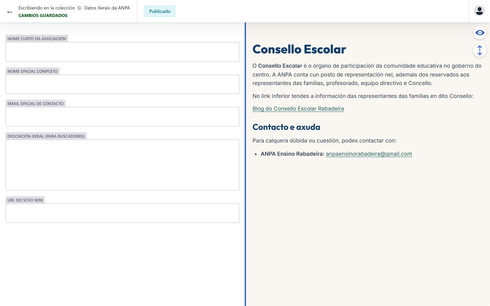

# Módulo 11: Datos Generales de la Asociación (site.json)

En este módulo aprenderás a gestionar la identidad corporativa y la configuración global de la ANPA a través de la colección **⚙️ Datos Xerais da ANPA**.

A diferencia de las noticias o páginas individuales, los datos de esta sección son **globales**: lo que modifiques aquí se actualiza de forma automática y transparente en todas las cabeceras, pies de página y etiquetas de posicionamiento en Google de todo el sitio web.

---

## 1. ¿Qué es esta sección y qué controla?

Controla el archivo global `src/_data/site.json`. Contiene los 5 datos de identidad legal e institucional de la asociación:

```
[ IDENTIDADE GLOBAL DA ANPA ]
 ├── 1. Nome curto da asociación (Cabecera, logotipo e copyright)
 ├── 2. Nome oficial completo (Bloque "Sobre a asociación" do pé de páxina)
 ├── 3. Email oficial de contacto (Centraliza TODOS os botóns de contacto da web)
 ├── 4. Descrición xeral para buscadores (Etiquetas SEO que leen Google e redes sociais)
 └── 5. URL do sitio web (Dominio base oficial)
```

---

## 2. Cómo acceder a Datos Generales en Decap CMS

1. Entra en `/admin/` e inicia sesión con tu usuario de GitHub.
2. En la barra lateral izquierda, baja hasta la última colección: **⚙️ Datos Xerais da ANPA**.
3. Haz clic en la ficha **Identidade e Contacto Xeral**.

---

## 3. Explicación de los 5 campos del formulario

| Campo en pantalla (Gallego) | Nombre en Español | Tipo | ¿Dónde se muestra en la web? |
| :--- | :--- | :---: | :--- |
| **Nome curto da asociación** | Nombre corto | Texto | En el logotipo de la cabecera superior y en el mensaje de copyright del pie (*ANPA Ensino Rabadeira*). |
| **Nome oficial completo** | Nombre legal completo | Texto | En el primer bloque del pie de página de toda la web (*Asociación de Nais e Pais de Alumnos do CEIP Rabadeira*). |
| **Email oficial de contacto** | Correo oficial central | Texto | ⚠️ **CAMPO DE MÁXIMA RELEVANCIA:** Es el correo oficial (`anpaensinorabadeira@gmail.com`). Alimenta todos los botones de "Enviar correo" y enlaces `mailto:` de la web. |
| **Descrición xeral (para buscadores)** | Resumen SEO para Google | Texto | La descripción de texto que muestra Google en sus resultados cuando una familia busca a la ANPA en internet. |
| **URL do sitio web** | Dominio oficial de la web | Texto | La dirección oficial de publicación (`https://anpa-rabadeira-cms-test.netlify.app`). |


*Figura 25: Formulario de datos generales de la ANPA en Decap CMS mostrando los campos de nombre oficial, email de contacto y descripción SEO.*

---

## 4. El poder del correo oficial central (`email`)

Una de las grandes ventajas de nuestra web es que el correo oficial de la asociación **no está escrito a mano repetido página por página**:
* Está centralizado en la casilla **Email oficial de contacto**.
* Si la directiva decide cambiar de dirección de correo electrónico (o crear una cuenta específica), solo tienes que escribir el nuevo correo **una única vez aquí**.
* El sistema actualizará de golpe todos los botones de *"Contacta coa ANPA"* de la portada, el enlace del pie de página de todas las secciones y las llamadas de contacto del sitio web.

---

## 5. Tutorial Paso a Paso: Cómo actualizar el correo oficial de la asociación

**Ejemplo realista:** Se renueva la directiva y se activa una nueva cuenta de atención a familias.

1. Abre **⚙️ Datos Xerais da ANPA** -> **Identidade e Contacto Xeral**.
2. En la casilla **Email oficial de contacto**:
   * Borra la dirección antigua (`anpaensinorabadeira@gmail.com`).
   * Escribe la nueva dirección oficial (ej: `nova-directiva-anparabadeira@gmail.com`).
3. Comprueba que no hay espacios en blanco al principio ni al final del correo.
4. Pulsa en el botón azul superior **Guardar** (borrador seguro).
5. Pulsa en el botón verde **Publicar** -> **Publicar ahora**.
6. En aproximadamente 90 segundos, el nuevo correo estará activo en toda la web.

---

## 6. Qué se puede cambiar con total tranquilidad y qué no tocar
* ✅ **Se puede cambiar con tranquilidad:** El correo oficial de contacto, la descripción para buscadores (SEO) si se quiere mejorar lo que muestra Google, y el nombre legal si hubiera modificaciones estatutarias.
* 🚫 **NO MODIFIQUES la URL del sitio web:** La casilla `URL do sitio web` (`https://anpa-rabadeira-cms-test.netlify.app`) define la dirección base absoluta del servidor. Si introduces una dirección incorrecta, las etiquetas de compartir en redes sociales y buscadores no apuntarán al sitio web correcto.

---

## 7. Cómo comprobar el resultado en la web pública
1. Espera entre **1 y 2 minutos** tras haber publicado.
2. Abre cualquier página de la web (por ejemplo, la portada o `/novas/`).
3. Baja hasta el pie de página (*footer*):
   * Comprueba que en la columna "Contacto" aparece la nueva dirección de correo.
   * Haz clic sobre ella y comprueba que se abre tu programa de correo con el destinatario correcto.

---

## 8. Errores habituales y soluciones
* **"He cambiado el correo pero al hacer clic no se abre mi gestor de correo":**
  * *Solución:* Comprueba que en la casilla no hayas puesto la palabra `mailto:` delante ni espacios extra. En esta casilla solo se escribe el correo limpio (ej: `anpaensinorabadeira@gmail.com`), ya que la plantilla web se encarga automáticamente de añadir el protocolo `mailto:`.
