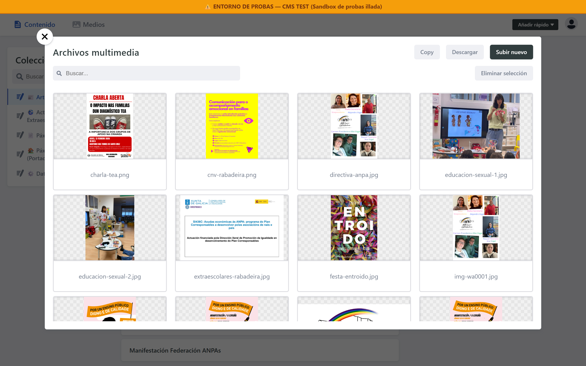

# Módulo 12: Gestión de Multimedia — Fotografías y Documentos PDF

En este módulo aprenderás las mejores prácticas para subir imágenes y folletos en PDF a la web de la ANPA sin sobrecargarla y garantizando que las familias puedan abrir los archivos con rapidez incluso con poca cobertura móvil.

---

## 1. ¿Qué es la Biblioteca de Medios (Media Library)?

La **Biblioteca de Medios** es el almacén central donde se guardan todas las fotos, logotipos, carteles y documentos PDF que se utilizan en la página web.

* Cuando estás editando un campo de imagen o archivo y pulsas en **Elegir una imagen** o **Elegir un archivo**, se abre la ventana de la biblioteca.
* También puedes abrirla en cualquier momento haciendo clic en el icono de imagen situado en la barra superior del panel de control.

*Figura 26: Ventana modal de la Biblioteca de Medios en Decap CMS con la cuadrícula de archivos subidos, buscador y botón "Subir nuevo".*

---

## 2. Buenas prácticas para Fotografías y Carteles

Una fotografía de mala calidad o excesivamente pesada puede arruinar el diseño de la web y consumir los datos móviles de las familias.

### Regla 1: Orientación siempre horizontal (paisaje)
* Los bloques de cabecera de las noticias y la foto principal de la portada están diseñados en formato apaisado (horizontal).
* **Evita fotos verticales:** Si subes una foto vertical hecha con el móvil de arriba a abajo, la web intentará recortarla o se verá desproporcionada.

### Regla 2: El tamaño del archivo (¡Ojo con las fotos directas del móvil!)
* Una foto tomada con un smartphone moderno suele pesar entre **8 y 15 Megabytes (MB)**. Subir una foto de 15 MB a la web es un error grave: tardará varios segundos en cargar en los teléfonos de las familias y consumirá su tarifa de datos.
* **El peso ideal:** Intenta que tus fotos pesen **menos de 500 Kilobytes (KB)** (o como máximo 1 MB).
* **Cómo reducir el peso gratis en 10 segundos:**
  1. Abre en tu navegador una herramienta gratuita como [squoosh.app](https://squoosh.app/) o [tinypng.com](https://tinypng.com/).
  2. Arrastra tu foto.
  3. Descárgala optimizada en formato **JPG** o **WebP**. Notarás que mantiene la misma nitidez pero pesa un 80% menos.

### Regla 3: Nombres de archivo limpios y sin símbolos raros
* **Mal:** `Foto asamblea ANPA final (1) con ñ & €.jpg`
* **Bien:** `asamblea-anpa-novembro-2026.jpg`
* *Consejo:* Usa solo letras minúsculas, números y guiones normales (`-`). Evita espacios, tildes, eñes (`ñ`) y caracteres extraños.

---

## 3. Buenas prácticas para Documentos PDF

Los trípticos, fichas de inscripción y memorias anuales se publican en formato PDF para que cualquier teléfono u ordenador pueda abrirlos sin desconfigurar la letra.

* **Peso máximo recomendado:** Entre **1 y 5 MB**. Si tu documento tiene muchas fotografías (como la Memoria Anual), exporta el PDF en calidad "Pantalla / Web" desde Word o Canva en lugar de calidad "Imprenta profesional".
* **Nombres descriptivos:** Nombra siempre el archivo indicando de qué trata y el curso escolar (ej: `triptico_madrugadores_2026-2027.pdf` o `memoria-curso-2026-2027.pdf`). Las familias guardan estos archivos en sus teléfonos y así podrán encontrarlos fácilmente.

---

## 4. Paso a paso: Cómo subir y seleccionar un archivo

1. En el editor de cualquier noticia o página, localiza el campo que pide la imagen o el archivo.
2. Haz clic en el botón **Elegir una imagen** (o **Elegir un archivo**).
3. Se abrirá la ventana emergente de la Biblioteca de Medios:
   * **Si el archivo ya lo habías subido antes:** Búscalo en la cuadrícula, haz clic sobre él para seleccionarlo y pulsa en el botón azul **Insertar**.
   * **Si es un archivo nuevo de tu ordenador:** Haz clic en el botón superior **Subir imagen** (*Upload*), selecciónalo en las carpetas de tu equipo y pulsa en Abrir.
4. Una vez cargado, selecciónalo y pulsa en **Insertar**.
5. Verás inmediatamente la miniatura en tu formulario y el resultado final maquetado en la vista previa derecha.

---

## 5. Errores habituales y soluciones
* **"He subido una foto pero la vista previa se queda en blanco o con icono de imagen rota":**
  * *Causa:* El nombre del archivo contenía espacios, tildes o caracteres especiales que el navegador no puede interpretar en la dirección web.
  * *Solución:* Renombra la foto en tu ordenador (ej: `foto-actividade.jpg`), vuelve a subirla y pulsa en Insertar.
* **"Quiero borrar una foto antigua de la biblioteca":**
  * *Paso:* Abre la Biblioteca de Medios desde el icono superior, haz clic en la foto que deseas eliminar y pulsa en el botón rojo de la papelera (**Eliminar**). *(Ten cuidado de no borrar imágenes que todavía se estén usando en otras noticias)*.
