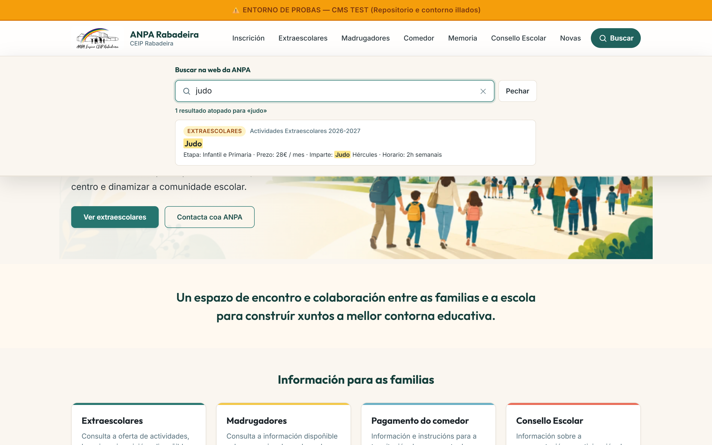

# Módulo 13: El Buscador General del Sitio Web

En este módulo conocerás cómo funciona el **Buscador General** (*Buscador xeral*) integrado en la cabecera de la web pública de la ANPA y qué debes tener en cuenta al redactar tus contenidos para que las familias encuentren todo a la primera.

---

## 1. ¿Qué es el Buscador General y dónde está?

En la cabecera de todas las páginas de la web pública, junto al logotipo y el menú de navegación, verás un botón con el icono de una lupa (🔍) titulado **Buscar na web**.

* En pantallas de ordenador se muestra como un botón claro y visible.
* En teléfonos móviles se muestra como un botón táctil compacto de 44x44 píxeles para que no estorbe al nombre del colegio ni al menú.
* Al pulsar sobre la lupa, se abre una ventana modal accesible donde cualquier madre, padre o tutor puede escribir cualquier palabra (por ejemplo: *"judo"*, *"horario"*, *"atriga"*, *"25€"*, *"bajas"*) y ver al instante todos los resultados relevantes ordenados con enlaces directos.

*Figura 27: Ventana modal del buscador del sitio web mostrando la búsqueda en vivo con resultados clasificados por categoría temática.*

---

## 2. ¿Cómo se actualiza el buscador? (¡Es 100% automático!)

Como persona administradora del CMS, **no tienes que configurar nada, ni pulsar ningún botón especial, ni pagar por ningún servicio de búsqueda externo**.

### ¿Cómo funciona entre bambalinas?
1. Cada vez que tú pulsas **Publicar ahora** en el CMS, nuestro motor de compilación (Eleventy) lee todos los textos nuevos de tus noticias, páginas y extraescolares.
2. Durante ese minuto y medio de construcción en Netlify, Eleventy extrae automáticamente todas las palabras clave y genera un índice de búsqueda ultraligero.
3. En cuanto el despliegue termina, el buscador ya "sabe" lo que acabas de publicar.

---

## 3. Consejos de redacción para que las familias encuentren lo que buscan

Dado que el buscador lee los títulos y textos de tus noticias, sigue estas sencillas recomendaciones al escribir:

1. **Usa palabras naturales y cotidianas:**
   * Las familias buscarán palabras directas como *"comedor"*, *"madrugadores"*, *"precio"*, *"baja"*, *"inglés"*, *"chándal"*, *"festivo"*.
   * Si en una noticia sobre extraescolares solo escribes *"Novedades de la comisión lúdica"*, a una familia que busque *"judo"* le costará más encontrarla. Incluye siempre los nombres reales de las actividades o servicios en el texto.
2. **Titulares descriptivos:**
   * Mejor: *Prazos de inscrición e horarios para o servizo de Madrugadores*.
   * Peor: *Información importante para o curso*.
3. **No te preocupes por las tildes ni las mayúsculas:**
   * El buscador de la ANPA es inteligente: si una persona escribe *"musica"*, encontrará tanto *"Música e movemento"* con tilde como sin ella.
